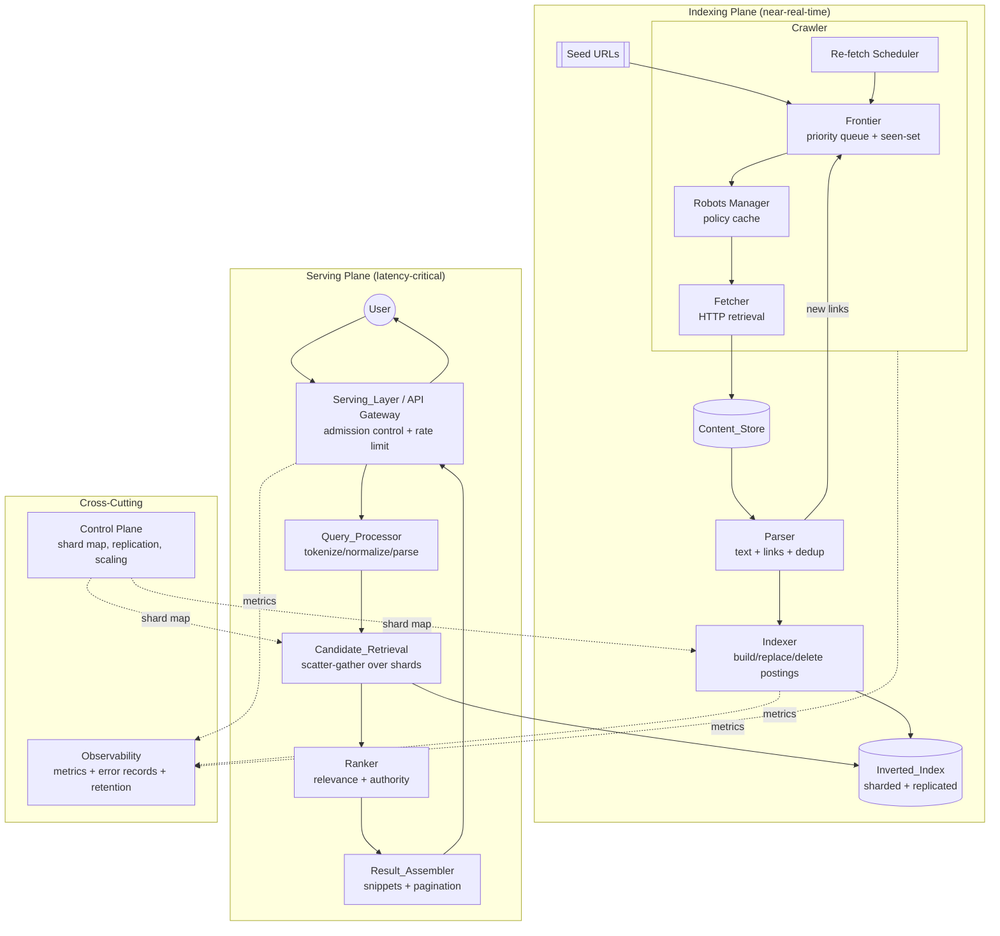
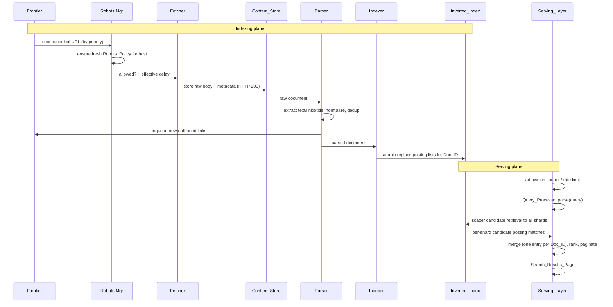
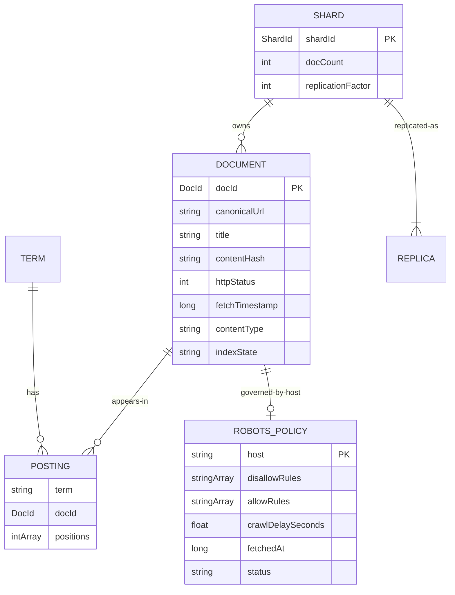
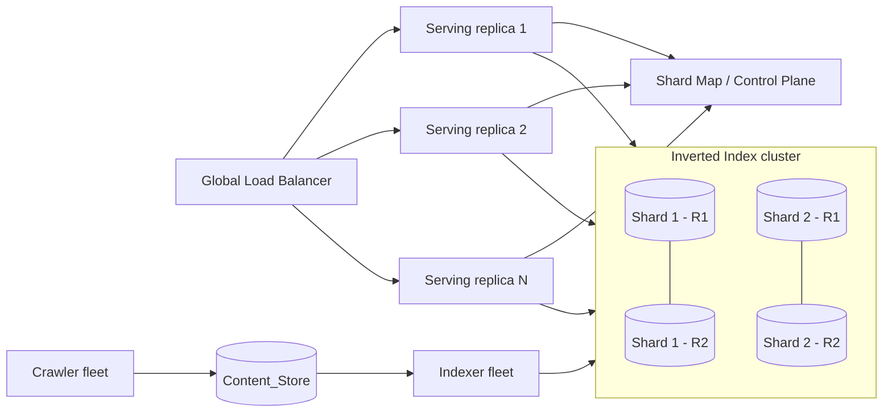

# Design Document: Web-Scale Search Engine (google-search)

## Overview

This document specifies BOTH the high-level design (HLD) and low-level design (LLD) for a
web-scale search engine comparable to Google Search. It elaborates the observable behavior
defined in `requirements.md` into concrete architecture, data models, algorithms, data
structures, and component interfaces.

The system is organized as a pipeline with two loosely coupled planes:

- **Indexing plane (offline / near-real-time):** Crawler → Content_Store → Parser → Indexer →
  Inverted_Index. This plane discovers, fetches, parses, and indexes the public web.
- **Serving plane (online, latency-critical):** Serving_Layer → Query_Processor →
  Candidate_Retrieval → Ranker → Result_Assembler. This plane answers user queries against the
  Inverted_Index within a strict latency budget.

The two planes are deliberately decoupled: the indexing plane writes immutable/atomically-swapped
index segments, and the serving plane reads them. This separation lets each plane scale
independently (Requirement 14) and lets the serving plane meet its 500 ms P99 latency target
(Requirement 12) without contending with crawl/index workloads.

### Design Goals Traceability

| Goal | Driving Requirements |
| --- | --- |
| Discover and schedule the reachable web deterministically | 1, 2 |
| Fetch reliably with retry/redirect/error handling | 3 |
| Parse and normalize consistently with query-time normalization | 4, 7 |
| Build a correct, atomically-updatable, sharded inverted index | 5 |
| Keep the index fresh and remove dead documents | 6 |
| Parse queries robustly and reversibly | 7 |
| Retrieve exactly the matching candidates, including phrases | 8 |
| Rank deterministically using relevance + authority | 10 |
| Serve readable, paginated results | 11 |
| Meet 500 ms P99 latency and throughput under load | 12 |
| Stay available under replica/shard failure | 13 |
| Scale with corpus and traffic growth | 14 |
| Expose metrics and error records | 15 |

> Note: The requirements document has no "Requirement 9"; numbering jumps from 8 to 10. This
> design preserves the original requirement numbers for traceability.

## Architecture

### High-Level Component Diagram



### Data Flow (crawl → parse → index → serve)



### Architectural Decisions and Rationale

1. **Two-plane separation (indexing vs serving).** The serving plane must hit 500 ms P99
   (Req 12); coupling it to crawl/index I/O would introduce unbounded tail latency. Index
   segments are produced offline and swapped atomically (Req 5.4), so readers never block on
   writers. *Rationale: latency isolation + independent scaling (Req 14).*

2. **Document-partitioned sharding (partition by Doc_ID), not term-partitioned.** Each shard
   holds a full local inverted index for its subset of documents (Req 5.7, 8.3). A query is
   scattered to all shards and results are gathered. *Rationale: document partitioning keeps
   per-query fan-out bounded and predictable, supports simple phrase matching within a shard,
   and makes replication (Req 13) and rebalancing (Req 14.3) straightforward — each Doc_ID lives
   in exactly one shard's primary set, replicated N ways.*

3. **Shared normalization procedure.** Parser (Req 4.3) and Query_Processor (Req 7.1) call the
   exact same `normalize()` implementation. *Rationale: index terms and query terms must match
   byte-for-byte or retrieval silently fails.*

4. **Deterministic ordering everywhere.** Frontier ordering (Req 1.4), candidate merge (Req 8.3),
   and ranking tie-breaks (Req 10.3) all break ties on a canonical, total key. *Rationale:
   reproducibility and testability (Req 10.5).*

5. **Scatter-gather with per-shard deadline + replica failover.** Candidate retrieval issues
   parallel requests to one healthy replica per shard with a 200 ms shard deadline (Req 12.4),
   failing over to another replica (Req 13.2) and degrading to partial results if a shard is
   fully unavailable (Req 13.4).

## Components and Interfaces

This section defines the class/interface contracts for each major component (LLD). Signatures are
given in TypeScript-style pseudocode for precision; the target implementation language may differ.

### 1. Crawler subsystem

#### 1.1 Frontier

```typescript
interface FrontierEntry {
  canonicalUrl: string;      // normalized absolute URL (dedup key)
  priority: number;          // higher = fetched sooner
  retryCount: number;        // incremented on transient failure (Req 3.2)
  host: string;
  discoveredAt: number;      // epoch ms
}

interface Frontier {
  // Req 1.1 / 1.3: add if syntactically valid and not already present in Frontier or Content_Store.
  // Req 1.6: dedups by canonicalUrl (retains exactly one entry per Canonical_URL).
  add(url: string): AddResult;              // AddResult ∈ {Added, DuplicateSkipped, InvalidRejected, AlreadyFetched}

  // Req 1.4 / 1.5: pop the highest priority entry; ties broken by ascending canonicalUrl; removes it.
  next(): FrontierEntry | null;

  contains(canonicalUrl: string): boolean;  // membership via seen-set (bloom filter + exact set)
  reschedule(entry: FrontierEntry, newRetryCount: number): void;  // Req 3.2
  size(): number;
}
```

Internals: a max-priority queue keyed by `(priority desc, canonicalUrl asc)`, plus a
`SeenSet` (see Data Structures) that also consults Content_Store membership for Req 1.3.

#### 1.2 Robots Manager

```typescript
interface RobotsPolicy {
  host: string;
  disallowRules: string[];       // path prefixes disallowed
  allowRules: string[];          // explicit allows (longest-match wins)
  crawlDelaySeconds: number | null;
  fetchedAt: number;             // for refresh-interval check (Req 2.7)
  status: "loaded" | "missing" | "malformed"; // Req 2.2 / 2.3
}

interface RobotsManager {
  // Req 2.1: ensures a policy exists before any content fetch for the host.
  // Req 2.7: re-fetches if older than refreshIntervalSeconds.
  ensurePolicy(host: string): RobotsPolicy;

  // Req 2.4: returns whether a URL path is allowed.
  isAllowed(url: string): boolean;

  // Req 2.5 / 2.6: max(configured minDelay, policy.crawlDelay) clamped to [0.1, 60] s.
  effectiveDelaySeconds(host: string): number;
}
```

Failure handling: `ensurePolicy` treats fetch failure or malformed content as "no restrictions"
(Req 2.2) and not-found as "all allowed" (Req 2.3), recording the condition via Observability.

#### 1.3 Fetcher

```typescript
type FetchOutcome =
  | { kind: "Stored"; record: ContentRecord }            // Req 3.1
  | { kind: "Retry"; retryCount: number }                // Req 3.2 (5xx / timeout)
  | { kind: "Redirect"; target: string }                 // Req 3.4
  | { kind: "FailedPermanent"; reason: FailReason };     // Req 3.3 / 3.5 / 3.6

type FailReason = "maxRetries" | "redirectLimit" | "clientError4xx";

interface Fetcher {
  // Applies timeout ∈ [1,120]s (default 30). Honors RobotsManager delay before firing.
  fetch(entry: FrontierEntry, policy: RobotsPolicy): FetchOutcome;
}
```

The Crawler orchestrator interprets `FetchOutcome`: `Retry` reschedules with `retryCount+1`
(Req 3.2) up to max attempts ∈ [1,10] default 3 (Req 3.3); `Redirect` enqueues the target and
records the source→target edge (Req 3.4), enforcing a redirect-chain cap ∈ [1,20] default 5
(Req 3.5); `FailedPermanent` marks the URL failed and excludes it from scheduling (Req 3.3/3.5/3.6).
Every attempt records timestamp + status (Req 3.7).

#### 1.4 Re-fetch Scheduler

```typescript
interface RefetchScheduler {
  // Req 6.3: adaptive interval — decrease on detected change, increase on no change,
  // clamped to [minInterval >= 1 min, maxInterval <= 30 days].
  nextInterval(docId: DocId, changed: boolean, prevInterval: number): number;
  schedule(docId: DocId, canonicalUrl: string, at: number): void;
}
```

### 2. Parser subsystem

```typescript
interface ParsedDocument {
  docId: DocId;
  canonicalUrl: string;
  title: string | null;
  normalizedTokens: Token[];     // via shared normalize()
  outboundLinks: string[];
  contentHash: string;           // hash of normalized content for dedup (Req 4.6)
  status: "parsed" | "parseFailedUnsupportedType" | "parseFailedTooLarge"; // Req 4.4 / 4.5
}

interface Parser {
  parse(raw: ContentRecord): ParsedDocument;   // Req 4.1 / 4.2 / 4.3
  // Req 4.6: registers contentHash; duplicates collapse to lexicographically smallest Canonical_URL.
  resolveDuplicate(contentHash: string, canonicalUrl: string): string;
}
```

### 3. Shared Normalization (used by Parser AND Query_Processor)

```typescript
interface Token { text: string; }  // position is assigned by context (index or query)

// Req 4.3 & 7.1: single source of truth. Deterministic: same input -> same output.
function normalize(rawText: string): Token[];
//  Procedure: Unicode NFKC -> lowercase (case-fold) -> split on Unicode whitespace/punctuation
//  boundaries -> drop empty tokens -> collapse repeated whitespace. Pure function.
```

### 4. Indexer subsystem

```typescript
interface Posting {
  docId: DocId;
  positions: number[];       // ascending term positions within the document (Req 5.2)
}

interface Indexer {
  index(doc: ParsedDocument): IndexResult;   // Req 5.1 / 5.2 / 5.3 (assigns unique Doc_ID)
  // Req 5.4: atomic replace — no query observes a mix of old/new postings for a Doc_ID.
  reindex(doc: ParsedDocument): IndexResult;
  // Req 5.5 / 6.2: remove every posting referencing docId.
  remove(docId: DocId): IndexResult;
  // Req 5.7: assign docId to exactly one shard.
  shardFor(docId: DocId): ShardId;
}
// IndexResult carries success | revertedOnFailure (Req 5.6, transactional per Doc_ID).
```

The Indexer assigns Doc_IDs from a monotonic allocator (uniqueness, Req 5.3) and maps
`shardFor(docId) = hash(docId) mod shardCount` via the control-plane shard map (Req 5.7, 14.3).
Atomic replace (Req 5.4) is implemented by building a new per-Doc_ID segment and swapping a
pointer under a per-shard lock; failure discards the new segment (Req 5.6).

### 5. Query_Processor subsystem

```typescript
type QueryNode =
  | { type: "term"; token: string }
  | { type: "phrase"; tokens: string[] }             // Req 7.2 ordered constraint
  | { type: "operator"; op: SupportedOp; operands: QueryNode[] }; // Req 7.3

interface StructuredQuery {
  nodes: QueryNode[];     // ordered
}

interface QueryProcessor {
  // Req 7.1: shares normalize(); Req 7.8: truncates normalized length to 2048 first.
  // Req 7.6: unbalanced quote -> literal token; Req 7.7: unknown operator -> literal token.
  parse(rawQuery: string): StructuredQuery;
  // Req 7.5: serialize(parse(q)) parses to an equivalent StructuredQuery (round-trip).
  serialize(q: StructuredQuery): string;
  isEmpty(q: StructuredQuery): boolean;   // Req 7.4
}
```

### 6. Candidate_Retrieval + Ranker + Serving

```typescript
interface Candidate { docId: DocId; matchedPositions: Map<string, number[]>; }

interface CandidateRetrieval {
  // Req 8.1: AND semantics over required terms; Req 8.2: phrase adjacency; Req 8.3: shard union,
  // one entry per Doc_ID; Req 12.4/13: per-shard 200ms deadline + replica failover.
  retrieve(q: StructuredQuery): { candidates: Candidate[]; partial: boolean; missingShards: number };
}

interface Ranker {
  // Req 10.1: score ∈ [0,1]; Req 10.4: relevance + authority components; Req 10.2/10.3: order by
  // score desc, tie-break docId asc; Req 10.7: exclude scoring failures, preserve rest.
  rank(q: StructuredQuery, candidates: Candidate[]): RankedResult[];
}

interface ResultEntry { title: string; canonicalUrl: string; snippet: string; }

interface ServingLayer {
  // Orchestrates: admission (Req 12.3), parse (Req 7), retrieve (Req 8), rank (Req 10),
  // paginate (Req 11), and emit metrics (Req 15.1).
  search(rawQuery: string, page: number, pageSize: number): SearchResultsPage;
}

interface SearchResultsPage {
  entries: ResultEntry[];      // <= pageSize (Req 11.3)
  status: PageStatus;          // ok | noQueryTerms | noMatches | noFurtherResults
                               // | invalidPage | overloaded | partialResult | incompleteShardCoverage
  page: number;
  partialShardCount?: number;  // Req 12.4 / 13.4
}
```

## Data Models



### Core Data Model Definitions

- **Doc_ID:** opaque monotonically-allocated unique integer/string; stable for a Document's
  lifetime; unique across the whole index (Req 5.3). `shardFor(docId)` is a pure function of Doc_ID.
- **Document:** `{docId, canonicalUrl, title, contentHash, httpStatus, fetchTimestamp,
  contentType, indexState ∈ {indexed, removed, parseFailed, fetchFailed}}` (Req 3.1, 4.4/4.5, 5, 6.2).
- **Posting / Posting_List:** a term maps to an ascending-Doc_ID list of `{docId, positions[]}`
  where `positions` is ascending (Req 5.1, 5.2). Positions enable phrase matching (Req 8.2).
- **Inverted_Index:** `Map<Shard, Map<Term, Posting_List>>`; each Doc_ID in exactly one Shard's
  primary set (Req 5.7), each Shard replicated ≥2× (Req 13.1).
- **Frontier entry:** see `FrontierEntry` above (Req 1, 3.2).
- **Robots_Policy:** see `RobotsPolicy` above (Req 2).
- **StructuredQuery / QueryNode:** ordered term/phrase/operator tree (Req 7).
- **Search_Results_Page:** see `SearchResultsPage` above (Req 11, 12, 13).
- **ContentRecord (Content_Store):** `{canonicalUrl, finalUrl, rawBody, httpStatus,
  fetchTimestamp, contentType}` (Req 3.1, 3.7).

### Sharding, Partitioning, and Replication Strategy

- **Partitioning:** document-partitioned. `shardId = hash(docId) mod shardCount`. Each Doc_ID
  belongs to exactly one shard (Req 5.7). A query fans out to all shards (Req 8.3).
- **Replication:** each shard is stored on `replicationFactor ≥ 2` independent replicas
  (Req 13.1). Reads target one healthy replica; on health-check failure within ≤5 s the Serving_Layer
  fails over to another replica (Req 13.2). Full-shard loss degrades to partial results (Req 13.4).
- **Rebalancing:** when a shard reaches max Documents/shard, the control plane adds shards and
  remaps a subset of Doc_IDs using consistent hashing so each Doc_ID stays assigned to exactly
  one shard with no loss/duplication (Req 14.1, 14.3).

### Latency Budget (500 ms P99 target — Req 12.1/12.2)

| Stage | Budget (ms) | Notes |
| --- | --- | --- |
| Admission + rate-limit check | 5 | Req 12.3 |
| Query parse/normalize | 10 | Req 7 (pure, in-memory) |
| Scatter to shards + network | 20 | parallel fan-out |
| Per-shard candidate retrieval | 200 | hard shard deadline (Req 12.4) |
| Gather + merge (one/Doc_ID) | 30 | Req 8.3 |
| Ranking | 120 | Req 10, bounded candidate set |
| Snippet + page assembly | 80 | Req 11 |
| Serialization + egress | 35 | |
| **Total P99** | **~500** | headroom via early shard-deadline cutoff |

Shard retrieval and ranking dominate; the 200 ms shard deadline caps tail latency, and partial
results (Req 12.4) protect the budget when a shard is slow.

### Deployment / Scaling View



Serving replicas scale horizontally on query rate (Req 14.2); shards scale on corpus size
(Req 14.1). Capacity exhaustion is recorded when neither can be provisioned (Req 14.4).

## Low-Level Design: Core Algorithms

### A. URL Normalization → Canonical_URL (Req 1.4, 1.6, 4.6)

```
function canonicalize(url):
    if not isAbsoluteValidUrl(url): return INVALID          # Req 1.2
    scheme = lowercase(url.scheme)                           # http/https only
    host   = lowercase(punycode(url.host)); strip trailing '.'
    port   = drop if default-for-scheme
    path   = removeDotSegments(percentDecodeUnreserved(url.path)); collapse '//'
    if path == "": path = "/"
    query  = sortQueryParams(dropTrackingParams(url.query))  # stable, deterministic
    fragment = ""                                            # drop fragment
    return normalizedString(scheme, host, port, path, query)
```

Deterministic total function; two URLs that differ only in case/default-port/fragment/param-order
map to the same Canonical_URL, satisfying dedup (Req 1.6).

### B. Frontier Prioritization (Req 1.4, 1.5)

Ordering key is the total order `(-priority, canonicalUrl)`. `priority` blends host authority,
discovery depth, and re-fetch urgency. `next()` pops the minimum of this key (highest priority,
then smallest Canonical_URL) and removes it, guaranteeing deterministic scheduling.

### C. Shared Tokenization / Normalization (Req 4.3, 7.1)

Single pure function `normalize()` (defined in Components §3). Procedure: NFKC → case-fold →
boundary split → drop empties → collapse whitespace. Because Parser and Query_Processor both call
it, an index term and a query term for the same surface text are always byte-identical.

### D. Inverted Index Construction (Req 5.1–5.7)

```
function buildSegment(doc):
    seg = {}                                # term -> ascending positions
    for (pos, token) in enumerate(doc.normalizedTokens):
        seg[token].append(pos)              # positions naturally ascending (Req 5.2)
    return seg                              # one immutable segment per Doc_ID

function reindex(doc):                      # Req 5.4 atomic replace
    newSeg = buildSegment(doc)
    lock(shardFor(doc.docId)):
        tmp = clonePointerTable()
        removeDocIdPostings(tmp, doc.docId) # drop old
        mergeSegment(tmp, doc.docId, newSeg)
        try: commitSwap(tmp)                # single pointer swap = atomic
        except: discard(tmp); record(failure); return revertedOnFailure   # Req 5.6
```

### E. Candidate Retrieval + Shard Merge (Req 8.1–8.4, 12.4, 13)

```
function retrieve(q):
    required = requiredTerms(q)
    partial, missing = false, 0
    perShard = parallelForEach(shards, deadline=200ms):    # Req 12.4
        replica = pickHealthyReplica(shard)                # Req 13.2 failover
        if replica is None: partial=true; missing+=1; skip # Req 13.4
        lists = [replica.postings(t) for t in required]
        cands = intersectByDocId(lists)                    # AND semantics (Req 8.1)
        if hasPhrase(q): cands = filterPhrase(cands, q)    # Req 8.2
        return cands
    merged = unionByDocId(perShard)                        # one entry per Doc_ID (Req 8.3)
    return { candidates: merged, partial, missing }
```

### F. Phrase / Positional Matching (Req 8.2)

```
function phraseMatches(doc, phraseTokens):
    posLists = [doc.positions(tok) for tok in phraseTokens]  # any missing -> false
    for p in posLists[0]:
        if all( (p + i) in posLists[i] for i in 1..len-1 ):  # consecutive, no gaps
            return true
    return false
```

### G. Ranking (Req 10.1–10.7)

Relevance_Score combines a **term-relevance** component (BM25 over query terms) and a
**document-authority** component (PageRank-style, precomputed from the link graph the Fetcher
records in Req 3.4). Both are normalized to `[0,1]` and blended:

```
score(doc, q) = clamp01( w_r * bm25Norm(doc, q) + w_a * authorityNorm(doc) )   # Req 10.1, 10.4
                where w_r + w_a = 1
order: sort by (score desc, docId asc)                                         # Req 10.2, 10.3
on scoring exception for a doc: skip doc, record failure, keep others          # Req 10.7
empty candidates -> empty page, no error                                       # Req 10.6
```

`bm25Norm` uses a bounded squashing function so the term component lies in `[0,1]`; `authorityNorm`
is min-max normalized against the corpus. Determinism (Req 10.5) follows from pure inputs plus the
total-order tie-break on Doc_ID.

### H. Pagination (Req 11.3–11.6)

```
function paginate(ranked, page, pageSize):
    if page not integer or page < 1: return page(status=invalidPage, [])   # Req 11.6
    start = (page-1) * pageSize
    if start >= len(ranked): return page(status=noFurtherResults, [])      # Req 11.5
    slice = ranked[start : start+pageSize]                                  # <= pageSize (Req 11.3)
    return page(status=ok, slice)                                          # disjoint across pages (Req 11.4)
```

Because `ranked` is a stable total order, consecutive pages are disjoint contiguous slices, so no
item is repeated across pages of the same query (Req 11.4).

## Low-Level Design: Key Data Structures

| Structure | Purpose | Notes |
| --- | --- | --- |
| **Priority queue (binary heap)** keyed `(-priority, canonicalUrl)` | Frontier ordering | O(log n) push/pop; deterministic (Req 1.4) |
| **SeenSet = Bloom filter + exact hash set** | Frontier/Content_Store dedup | Bloom gives fast negative; exact set confirms to avoid false-positive drops (Req 1.3, 1.6) |
| **Term dictionary** (sorted string table / FST) | Term → posting-list offset | Compact prefix-compressed keys |
| **Posting list encoding** | Compact postings | Delta-encoded ascending Doc_IDs + varint; positions delta-encoded ascending (Req 5.1, 5.2) |
| **Per-Doc_ID immutable segment + pointer table** | Atomic replace | Single-pointer swap gives atomicity (Req 5.4, 5.6) |
| **Content hash index** (hash → smallest Canonical_URL) | Duplicate detection | Req 4.6 |
| **Monotonic Doc_ID allocator** | Unique Doc_IDs | Req 5.3 |
| **Consistent-hash shard map** | Doc_ID → Shard | Minimal remap on scale-out (Req 5.7, 14.1, 14.3) |

## Error Handling

Error handling paths map directly to the requirements' IF-THEN acceptance criteria:

| Condition | Handling | Requirement |
| --- | --- | --- |
| Invalid/non-absolute URL | Exclude from Frontier, record invalid-URL condition | 1.2 |
| Robots fetch fails / malformed | Treat as no restrictions, record failure, use min delay | 2.2 |
| Robots not-found | Treat all allowed, use min delay | 2.3 |
| URL disallowed by robots | Exclude from fetching, record exclusion | 2.4 |
| 5xx / request timeout | Reschedule with retryCount+1 | 3.2 |
| Max retries reached | Mark failed, stop scheduling | 3.3 |
| 3xx redirect | Enqueue target, record source→target edge | 3.4 |
| Redirect chain > max | Stop, mark originating URL failed (redirect-limit), stop scheduling | 3.5 |
| 4xx response | Mark failed (no reschedule), record timestamp+status | 3.6 |
| Unsupported content type | Record parse-failure, skip indexing | 4.4 |
| Document too large | Record parse-failure, skip indexing | 4.5 |
| Partial index update fails | Revert to prior state, record indexing failure | 5.6 |
| Doc returns 404/410 on re-fetch | Remove from index within Freshness_Interval | 6.2 |
| Empty query after normalization | Empty page, status = noQueryTerms | 7.4 |
| Unbalanced quote | Treat unmatched quote as literal token, continue | 7.6 |
| Unsupported operator | Treat as literal token, continue | 7.7 |
| Query > 2048 chars | Truncate to first 2048 before tokenization | 7.8 |
| No matching documents | Empty page, status = noMatches | 8.4 |
| Scoring failure for a doc | Exclude doc, record failure, preserve rest | 10.7 |
| Empty candidate set | Empty ordered page, no error | 10.6 |
| Missing title/snippet | Substitute Canonical_URL / empty snippet | 11.7 |
| Invalid page (<1 or non-int) | Empty page, status = invalidPage | 11.6 |
| Page beyond last results | Empty page, status = noFurtherResults | 11.5 |
| Query rate > peak | Reject excess, status = overloaded | 12.3 |
| Shard slow (>200 ms) | Return partial from responders, record count | 12.4 |
| Replica health-check fail | Failover to healthy replica of same shard | 13.2 |
| All replicas of a shard down | Partial results, status = incompleteShardCoverage | 13.4 |
| No scale-out capacity | Record capacity-exhaustion condition | 14.4 |
| Metric/error record write fails | Complete primary op, record recording-failure | 15.6 |

## Correctness Properties

*A property is a characteristic or behavior that should hold true across all valid executions of a
system — essentially, a formal statement about what the system should do. Properties serve as the
bridge between human-readable specifications and machine-verifiable correctness guarantees.*

The following properties were derived from the acceptance-criteria prework analysis. Each is a
universally quantified statement suitable for property-based testing, annotated with the
requirements it validates. Redundant criteria were consolidated (see prework reflection), and
purely infrastructural/SLO criteria (6.1, 12.1, 12.2, 13.1, 13.5, 14.2, 15.5) are covered by
integration/smoke tests instead.

### Property 1: Frontier membership and canonical dedup

*For any* set of URLs (valid and invalid, including multiple variants that normalize to the same
Canonical_URL), after adding all of them the Frontier contains exactly one entry per distinct valid
Canonical_URL, contains no invalid URLs, and adding an already-present or already-fetched URL never
increases its entry count.

**Validates: Requirements 1.1, 1.2, 1.3, 1.6**

### Property 2: Deterministic Frontier ordering

*For any* set of Frontier entries, draining the Frontier via repeated `next()` yields entries in the
total order `(priority descending, Canonical_URL ascending)`, and the same input set always produces
the identical draining sequence.

**Validates: Requirements 1.4**

### Property 3: Selection removes from Frontier

*For any* non-empty Frontier, calling `next()` returns an entry, decreases the size by exactly one,
and the returned Canonical_URL is no longer contained in the Frontier.

**Validates: Requirements 1.5**

### Property 4: Robots effective delay computation

*For any* configured minimum delay and any (possibly null) robots crawl-delay, the effective delay
equals `clamp(max(minDelay, crawlDelay), 0.1, 60)` seconds and is never less than the configured
minimum delay.

**Validates: Requirements 2.5, 2.6**

### Property 5: Missing or unusable robots policy allows all

*For any* host whose robots policy fetch fails, returns malformed content, or is not found, and any
URL path on that host, `isAllowed` returns true and the effective delay equals the configured
minimum delay, with the condition recorded.

**Validates: Requirements 2.2, 2.3**

### Property 6: Robots allow/disallow decision

*For any* generated robots policy and any URL path, `isAllowed` returns false exactly when the
path's longest-matching rule is a disallow rule, and true otherwise.

**Validates: Requirements 2.4**

### Property 7: Robots refresh on staleness

*For any* robots policy with a `fetchedAt` timestamp and configured refresh interval, `ensurePolicy`
triggers a re-fetch if and only if the policy age exceeds the refresh interval.

**Validates: Requirements 2.7**

### Property 8: Successful fetch persists complete record

*For any* HTTP 200 response, the stored ContentRecord contains the raw body, fetch timestamp, HTTP
status code, final resolved URL, and content type equal to the fetched response's values.

**Validates: Requirements 3.1, 3.7**

### Property 9: Transient failure reschedules with incremented retry

*For any* Frontier entry that encounters an HTTP 5xx response or a request timeout, the entry is
rescheduled in the Frontier with `retryCount` incremented by exactly 1.

**Validates: Requirements 3.2**

### Property 10: Retry and redirect limits mark URL failed

*For any* URL that reaches the configured maximum retry count, or whose redirect chain exceeds the
configured maximum, the URL is marked failed (with reason `maxRetries` or `redirectLimit`
respectively) and is excluded from all further scheduling.

**Validates: Requirements 3.3, 3.5**

### Property 11: Redirect enqueues target and records edge

*For any* HTTP 3xx response, the redirect target URL is added to the Frontier and the
source→target redirect relationship is recorded.

**Validates: Requirements 3.4**

### Property 12: Client error fails without reschedule

*For any* HTTP 4xx response, the URL is marked failed, is not rescheduled, and the fetch timestamp
and HTTP status code are recorded in the Content_Store.

**Validates: Requirements 3.6**

### Property 13: Parser extracts text, links, and title without markup

*For any* HTML document, the parsed output's normalized text contains no markup tags, script, or
style content, and the extracted outbound links and title equal those present in the document.

**Validates: Requirements 4.1, 4.2**

### Property 14: Shared deterministic normalization

*For any* input text, the normalization procedure is deterministic (`normalize(t) == normalize(t)`)
and the Parser and Query_Processor produce identical normalized token sequences for the same input.

**Validates: Requirements 4.3, 7.1**

### Property 15: Unsupported content type is not indexed

*For any* document whose declared content type is not in the configured supported set, the Parser
records a parse-failure status and the document is not added to the Inverted_Index.

**Validates: Requirements 4.4**

### Property 16: Duplicate content collapses to smallest Canonical_URL

*For any* set of documents that produce identical normalized content, they are marked duplicates and
associated with the single lexicographically smallest Canonical_URL among the set.

**Validates: Requirements 4.6**

### Property 17: Indexing populates postings and positions

*For any* parsed document, after indexing, the posting list of every distinct term the document
contains includes the document's Doc_ID together with that term's exact ascending positions within
the document.

**Validates: Requirements 5.1, 5.2**

### Property 18: Doc_ID uniqueness

*For any* sequence of documents indexed for the first time, all assigned Doc_IDs are distinct across
the entire Inverted_Index.

**Validates: Requirements 5.3**

### Property 19: Atomic re-index (no mixed state)

*For any* document that is re-indexed after content change, every observable index snapshot exposes
either only the prior posting entries or only the current posting entries for that Doc_ID, never a
mixture.

**Validates: Requirements 5.4**

### Property 20: Removal deletes all postings for a Doc_ID

*For any* indexed document that is removed (including re-fetch returning HTTP 404 or 410), no posting
list in the Inverted_Index references that Doc_ID afterward, and it is returned as a candidate for no
query.

**Validates: Requirements 5.5, 6.2**

### Property 21: Indexing failure reverts to prior state

*For any* indexing operation that fails after partial posting updates, the Inverted_Index equals its
prior state (all-or-nothing) and the indexing failure is recorded.

**Validates: Requirements 5.6**

### Property 22: Each Doc_ID lives in exactly one Shard

*For any* Doc_ID, `shardFor` returns a single deterministic Shard, and across the whole index each
Doc_ID is a member of exactly one Shard's primary set.

**Validates: Requirements 5.7**

### Property 23: Adaptive re-fetch interval direction and bounds

*For any* sequence of change/no-change observations, the re-fetch interval decreases after a detected
content change and increases after unchanged content, and always remains within the configured
`[minInterval ≥ 1 minute, maxInterval ≤ 30 days]` bounds.

**Validates: Requirements 6.3**

### Property 24: Query normalization invariance

*For any* query, two variants differing only in letter case or in leading, trailing, or repeated
internal whitespace parse to identical StructuredQuery representations.

**Validates: Requirements 7.1**

### Property 25: Quoted phrases preserved as ordered constraints

*For any* query containing a quoted phrase, the parsed StructuredQuery contains a phrase node whose
tokens preserve the enclosed sequence in order.

**Validates: Requirements 7.2**

### Property 26: Supported operators interpreted per grammar

*For any* query using a supported operator, the parsed StructuredQuery contains the corresponding
operator node with operands as defined by the operator grammar.

**Validates: Requirements 7.3**

### Property 27: Query parse/serialize round-trip

*For any* query, parsing it, serializing the resulting StructuredQuery, and parsing again yields a
StructuredQuery equivalent to the first (same tokens, phrase constraints, and operators in the same
order).

**Validates: Requirements 7.5**

### Property 28: Robust parsing of malformed operators and quotes

*For any* query containing an unbalanced quote character or an unsupported operator, parsing succeeds
without rejecting the query, treating the offending element as a literal token and preserving the
remaining query tokens.

**Validates: Requirements 7.6, 7.7**

### Property 29: Required-term (AND) candidate membership

*For any* Inverted_Index and any normalized query with one or more required terms, a document is
included as a candidate if and only if it satisfies every required term constraint of the query.

**Validates: Requirements 8.1**

### Property 30: Phrase adjacency candidate membership

*For any* document and any phrase constraint, the document is included as a candidate if and only if
it contains every phrase token in the specified order at consecutive term positions with no
intervening tokens.

**Validates: Requirements 8.2**

### Property 31: Shard union with one entry per Doc_ID

*For any* collection of per-shard candidate sets, the merged candidate set equals the union of the
per-shard sets and contains exactly one entry per Doc_ID.

**Validates: Requirements 8.3**

### Property 32: Relevance_Score bounded to [0,1]

*For any* candidate document and query, the assigned Relevance_Score lies within `[0.0, 1.0]`
inclusive.

**Validates: Requirements 10.1**

### Property 33: Total ranking order (score then Doc_ID)

*For any* set of candidate documents, the Search_Results_Page is ordered by descending
Relevance_Score with ties broken by ascending Doc_ID, yielding a strict total order.

**Validates: Requirements 10.2, 10.3**

### Property 34: Score responds monotonically to both components

*For any* candidate document, increasing its term-relevance component while holding authority fixed
does not decrease its Relevance_Score, and increasing its document-authority component while holding
relevance fixed does not decrease its Relevance_Score (both components contribute).

**Validates: Requirements 10.4**

### Property 35: Deterministic ranking

*For any* query and unchanged index, ranking the same candidate set twice produces the identical
ordered Search_Results_Page.

**Validates: Requirements 10.5**

### Property 36: Scoring failure excludes only the failed document

*For any* candidate set where scoring fails for a subset of documents, those documents are excluded
from the Search_Results_Page, the relative order of the remaining documents is preserved, and each
failure is recorded.

**Validates: Requirements 10.7**

### Property 37: Result entries are complete with substitution

*For any* Search_Results_Page entry, it contains a title, a Canonical_URL, and a Snippet, where a
missing title is substituted by the Canonical_URL and a missing Snippet is substituted by an empty
string.

**Validates: Requirements 11.2, 11.7**

### Property 38: Pagination is bounded, ordered, and disjoint

*For any* ranked result list, page number, and page size, a page contains at most `pageSize` entries
in ranker order, and paginating through all pages yields disjoint slices whose concatenation equals
the full ranked list in order (no item repeated across pages).

**Validates: Requirements 11.1, 11.3, 11.4**

### Property 39: Admission control caps accepted rate

*For any* arrival pattern, the number of accepted queries per window does not exceed the configured
peak query rate, and every rejected query receives an overloaded status while accepted queries are
unaffected.

**Validates: Requirements 12.3**

### Property 40: Partial results on shard timeout

*For any* candidate retrieval in which a subset of shards do not respond within the 200 ms shard
deadline, the Search_Results_Page is computed from the responding shards, carries a partial-result
status, and records a non-responding-shard count equal to the number of timed-out shards.

**Validates: Requirements 12.4**

### Property 41: Replica failover selects a healthy replica

*For any* shard with at least one healthy replica, candidate retrieval routes to a healthy replica of
that shard.

**Validates: Requirements 13.2**

### Property 42: Coverage determines completeness vs partial

*For any* replica health state, if every shard has at least one healthy replica the Search_Results_Page
is complete (not partial); if any shard has zero healthy replicas the page is computed from the
responding shards and carries an incomplete-shard-coverage status.

**Validates: Requirements 13.3, 13.4**

### Property 43: Shard scale-out keeps docs-per-shard within bound

*For any* document distribution exceeding the configured maximum documents per shard, adding shards
results in every shard holding at or below the configured maximum.

**Validates: Requirements 14.1**

### Property 44: Rebalancing conserves Doc_IDs

*For any* pre-rebalance Doc_ID→Shard assignment, after adding a shard and reassigning, the set of
Doc_IDs is unchanged and each Doc_ID is assigned to exactly one shard (no loss, no duplication).

**Validates: Requirements 14.3**

### Property 45: Crawl and indexing cycle counts are consistent

*For any* completed crawl cycle, the recorded total fetch-attempt count equals the sum of successful
and failed fetch counts; and for any completed indexing cycle, the recorded added/updated/removed
counts equal the operations performed.

**Validates: Requirements 15.2, 15.3**

### Property 46: Per-query metric and error records are complete

*For any* served query a metric is recorded containing the measured Query_Latency and returned
Result_Entry count; and *for any* component operation failure an error record is recorded containing
the component name, operation name, failure cause, and timestamp.

**Validates: Requirements 15.1, 15.4**

### Property 47: Recording failure never aborts the primary operation

*For any* primary operation whose metric or error recording fails, the primary operation completes
successfully and a recording-failure indication is recorded.

**Validates: Requirements 15.6**

## Testing Strategy

This feature is well suited to property-based testing: the core of the system is composed of pure,
deterministic functions and data transformations (URL canonicalization, shared normalization, query
parse/serialize, inverted-index construction, phrase matching, candidate merge, ranking order,
pagination, rebalancing conservation). These have universal properties (round-trips, invariants,
idempotence, conservation, total orderings) that hold across large input spaces. Infrastructural and
SLO concerns (real latency percentiles, availability windows, storage retention, autoscaling
provisioning) are validated separately with integration/load/smoke tests.

### Dual Testing Approach

- **Property-based tests** verify the universal Correctness Properties above across many generated
  inputs. They target the pure logic layers using in-memory fakes/mocks for I/O (HTTP, storage,
  replicas) so they run fast and deterministically.
- **Unit / example tests** cover specific scenarios and edge cases identified in prework as EXAMPLE
  or EDGE_CASE: robots-before-content ordering (2.1), empty/whitespace query → `noQueryTerms` (7.4),
  query truncation at 2048 (7.8), max-retry boundary (3.3), redirect-limit boundary (3.5), too-large
  document boundary (4.5), no-match → `noMatches` (8.4), empty candidates → empty page (10.6),
  page-beyond-last → `noFurtherResults` (11.5), invalid page → `invalidPage` (11.6), and
  capacity-exhaustion recording (14.4).
- **Integration tests** cover pipeline freshness (6.1), end-to-end retrieval, and shard failover with
  a small cluster.
- **Load tests** verify the 500 ms P99 latency and throughput targets (12.1, 12.2) and the 30-day
  availability SLO (13.5) via sustained/chaos scenarios.
- **Smoke/schema checks** verify configuration invariants such as replication factor ≥ 2 (13.1) and
  metric/error record retention queryability (15.5).

### Property-Based Testing Requirements

- Use an established property-based testing library for the target language (for example, fast-check
  for TypeScript/JavaScript, Hypothesis for Python, jqwik for JVM, proptest for Rust). Do NOT
  implement property-based testing from scratch.
- Each property-based test MUST run a minimum of 100 iterations.
- Each property-based test MUST reference its design property via a tag comment in the format:
  **Feature: google-search, Property {number}: {property_text}**
- Each Correctness Property above MUST be implemented by a SINGLE property-based test.
- Generators must exercise edge cases flagged in prework (non-ASCII/Unicode text and encodings,
  empty content, non-HTML content, whitespace-only queries, unbalanced quotes, unknown operators,
  boundary sizes and counts) so those edge-case criteria are covered by the property generators.

### Test Data Generators (LLD)

- **URL generator:** absolute/relative/malformed URLs plus canonical-equivalent variants (case,
  default port, fragment, param order) to drive Properties 1–2 and 16.
- **HTML document generator:** documents with known tags, scripts, styles, links, and titles for
  Properties 13, 15, 17.
- **Query generator:** terms, quoted phrases (balanced and unbalanced), supported and unsupported
  operators, mixed case, and whitespace variants for Properties 24–28.
- **Index/candidate generator:** random posting lists with positions across multiple shards, with
  controlled overlaps, for Properties 17–22 and 29–31.
- **Score/authority generator:** candidate sets with controllable relevance and authority components,
  including forced ties and injected scoring failures, for Properties 32–36.
- **Health-state generator:** per-shard replica health vectors (full coverage and shard-loss cases)
  for Properties 40–42.
- **Assignment generator:** Doc_ID→Shard maps for rebalancing conservation, Properties 43–44.
